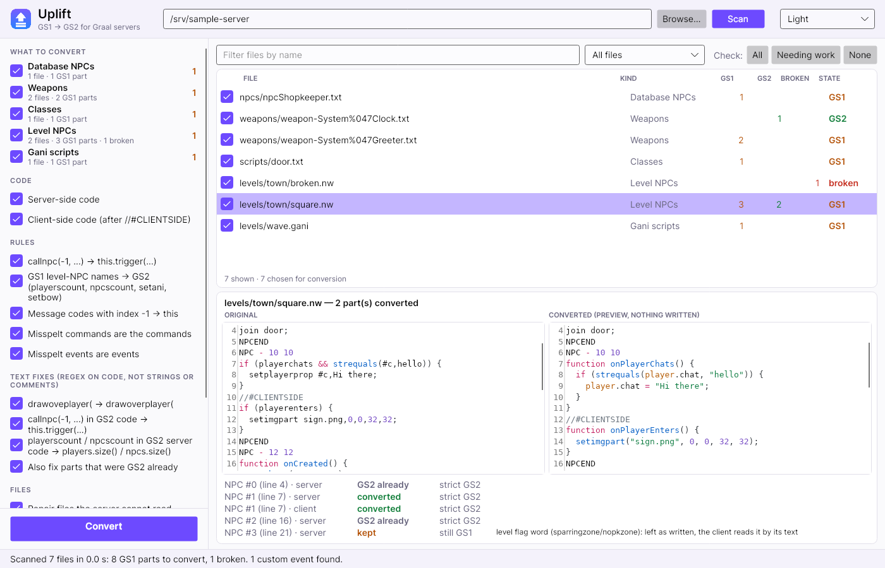

<p align="center"></p>

<h1 align="center">Uplift</h1>

<p align="center">Converts a Graal server's GS1 scripts to GS2: database NPCs, weapons, classes, level NPCs and ganis.</p>


Uplift opens a server folder, finds every script in it, and shows which ones are GS1, GS2 or broken. You tick what to convert,
preview every file before and after, side by side, and then convert. It comes as a window (light and dark themes) and as a
command line for scripts and automation. It is written in C# for .NET 10 and runs on Windows, Linux and macOS.

- **It reads scripts the way the server does.** A script means the same thing to Uplift as it does to the GS2 compiler it is
  built on.
- **It proves every result.** A conversion is only written when its output parses back to exactly the code it was printed
  from and passes a strict GS2 check.
- **It changes nothing it doesn't have to.** Comments are kept. Everything in a file outside the converted scripts stays
  byte for byte, line endings included.
- **It explains itself.** Every run writes a report: each part, what it was, what was done to it, what it is now, and why.
- **You can extend it** with rules, regex fixes, file formats and plugins.

## Contents

- [Using the window](#using-the-window)
- [Using the command line](#using-the-command-line)
- [How a script is converted](#how-a-script-is-converted)
- [Settings for a server (`uplift.json`)](#settings-for-a-server-upliftjson)
- [Rules, text fixes and plugins](#rules-text-fixes-and-plugins)
- [What to check after converting](#what-to-check-after-converting)
- [Building](#building)
- [Project layout](#project-layout)

## Using the window

1. Start `Uplift` and choose the server's folder: the one with `weapons/`, `scripts/`, `npcs/` and `levels/`. Uplift scans
   it and lists every script file, with how many of its parts are GS1, GS2 or broken.
2. On the left, choose what to convert:
   - the kinds of script;
   - server-side code, client-side code (after `//#CLIENTSIDE`), or both;
   - the rules and text fixes to apply (hover over one to see what it does);
   - where the result goes: a new folder (optionally with the unchanged files copied too), or in place with a backup.
3. Click a file to see it before and after conversion. The preview opens at the first change and lists each part's result
   and notes. Nothing is written yet.
4. Untick any files you want to leave alone, then click **Convert**. A banner shows the result, with buttons to open the
   output and the report.

The menu at the top right switches between the system theme, light and dark.



## Using the command line

```bash
uplift-cli scan /srv/myserver --list
uplift-cli convert /srv/myserver --out /srv/myserver-gs2 --copy-unchanged
uplift-cli convert /srv/myserver --in-place --only weapons,classes
uplift-cli convert /srv/myserver --out /tmp/trial --dry-run
uplift-cli check /srv/myserver-gs2 --quiet
uplift-cli part snippet.txt --kind weapon --side client
uplift-cli rules /srv/myserver
uplift-cli events /srv/myserver
uplift-cli init /srv/myserver
```

| Command | What it does |
| --- | --- |
| `scan` | Counts GS1, GS2 and broken files and parts per kind (`--list` lists every file that needs work). |
| `convert` | Converts and writes the files, with a report. |
| `check` | Runs the strict GS2 check on every part; the exit code is 1 when any part fails. |
| `part` | Converts one snippet file and prints the result. |
| `rules` | Lists the rules and text fixes, and whether each is on. |
| `events` | Lists the custom events the server's scripts send by name. |
| `init` | Writes a starter `uplift.json` into the server's folder. |

`convert` takes these options:

| Option | Meaning |
| --- | --- |
| `--out <folder>` / `--in-place` | Where the result goes. In place, every changed file is first copied to `.uplift/<time>/backup`. |
| `--only <kinds>` | `dbnpcs`, `weapons`, `classes`, `levels`, `ganis` (default: all). |
| `--sides <sides>` | `server`, `client` (default: both). |
| `--enable <ids>` / `--disable <ids>` | Switch rules or text fixes on or off. |
| `--files @list.txt` | Convert only the files listed (paths relative to the server). |
| `--copy-unchanged` | With `--out`: also copy the files that need no change, so the output is a complete copy. |
| `--no-repair` | Leave files the server cannot read as they are (a level's missing `NPCEND` or `GLEVNW01`, a gani's missing `SCRIPTEND`). |
| `--no-fix-gs2` | Run the text fixes on converted parts only, not on parts that were GS2 already. |
| `--report <folder>` | Where the report goes (default: `<out>.report`, or `.uplift/<time>/report` in place). |
| `--dry-run` | Convert and report, but write no script file. |
| `--jobs <n>` | Worker threads (default: half the processors, at most 8). |
| `--plugins <folder>` | Another folder of plugins (the `plugins` folder beside Uplift is always read). |

The report has four files:
- `parts.tsv`: every part, before and after, with notes and reasons;
- `files.tsv`: every file, whether it changed, and its problems and repairs;
- `warnings.txt`;
- `summary.json`.

## How a script is converted

**Why not just regular expressions?** Converting GS1 is a change of structure, not of spelling:
- **Events.** A GS1 script's main code runs once for *every* event, with that event's flag (`playerenters`, `timeout`,
  `actionfoo`, ...) set to true. GS2 has one function per event, so the main code has to be specialised for each event. The
  flags are folded to true or false, the dead branches dropped, and no call with side effects may be lost. If the script
  already has a function for an event, it runs after the main code, so the two are merged.
- **Comparison with `=`.** Inside a condition, `=` compares.
- **Old syntax.** Old commands take bare arguments (`setimg door.png;`) and message codes (`#c`, `#p(0)`, `#v(...)`) have
  to be read. `with` blocks on players and `players[0]` mean something different in GS2.
- **Strings and comments** must not change, and every comment has to stay with its statement.

So Uplift parses each part with the compiler's own GS1 and GS2 grammars (ANTLR). It uses regular expressions only where
they are safe: *text fixes* on the converted GS2 code, which never touch strings or comments.

**The steps:**

1. **Read.** Each file is read with the server's rules. For a level, the NPC blocks; for a weapon or database NPC, the
   script between its start and end lines; for a class, the whole file; for a gani, its `SCRIPT` block. Each script is split
   at its first real `//#CLIENTSIDE` marker. A marker inside a string or a comment doesn't count.
2. **Classify.** A part that already passes the strict GS2 check is left alone. One that compiles neither as GS1 nor as
   GS2 is reported as broken.
3. **Convert.** A GS1 part is parsed into a syntax tree, normalised, and rewritten by the enabled rules. Its main code is
   specialised for each event into `function onX()` handlers, and it is printed as GS2 with its comments.
4. **Prove.** The printed text must parse back to the same compiled code as the tree it came from, compile as GS2, and show
   none of the signs of GS1. Otherwise the part is left as it was and the report says why.
5. **Fix.** The enabled text fixes run. A fix that would break the strict check is left out.
6. **Write.** Only the replaced scripts change. Every other byte of the file stays as it was: 8-bit text is kept as it is,
   and each line keeps its `\r\n` or `\n`.

Client-side code is converted as well. A client that only runs GS2 needs its client code served as GS2 by the server.

## Settings for a server (`uplift.json`)

This file is optional and lives in the server's folder. `uplift-cli init` writes a starter one.

```json
{
  "folders": { "dbnpcs": "npcs", "weapons": "weapons", "classes": "scripts", "levels": "levels" },
  "customEvents": ["openshop"],
  "scanCustomEvents": true,
  "rules": { "command-typos": false },
  "textRules": [
    {
      "id": "rename-helper",
      "title": "oldhelper( → newhelper(",
      "pattern": "\\boldhelper\\s*\\(",
      "replacement": "newhelper(",
      "side": "server",
      "kinds": ["weapons", "classes"]
    }
  ],
  "events": { "playerjoinsguild": "onPlayerJoinsGuild" },
  "plugins": ["tools/MyServer.Uplift.dll"],
  "overrides": ".uplift/overrides"
}
```

| Setting | Meaning |
| --- | --- |
| `folders` | Where each kind of script lives, if not in the standard folders. |
| `customEvents`, `scanCustomEvents` | GS1 scripts send events by name (`callnpc`, `callweapon`, `trigger`, `scheduleevent`), and the receiving script tests the name as a flag. Uplift finds the names the scripts send, so `if (openshop)` becomes `function onOpenShop()` and is not read as a variable. Add any it cannot find. |
| `rules` | Rules and text fixes switched on (`true`) or off (`false`) by id. |
| `textRules` | Your own regular-expression fixes of GS2 code. |
| `events` | More GS1 event flags and the GS2 function each becomes. |
| `plugins` | Plugin assemblies (relative to the server's folder, or absolute). |
| `overrides` | A folder of hand conversions: `<hash>.gs2` replaces the part with that hash (the `hash` column of `parts.tsv`), and `<hash>.keep` (with the reason on its first line) leaves it as it is. Later runs use them. |

## Rules, text fixes and plugins

**Rules** rewrite the GS1 syntax tree before the events are split. What GS1 means is always converted; a rule is a choice,
such as a bug fix or a rewrite for engines that read something differently. The built-in rules are all on by default:

| Rule | What it does |
| --- | --- |
| `callnpc-self` | `callnpc(-1, "ev", ...)` (the current NPC) → `this.trigger("ev", ...)` |
| `gs1-level-names` | `playerscount`, `npcscount`, `setani`, `setbow` in level NPCs' server code → `players.size()`, `npcs.size()`, `player.setani()`, `player.bowimg =` |
| `self-message-codes` | `#3(-1)`, `#C0(-1)` ... (the NPC itself) → `this` |
| `command-typos` | `drawoveplayer`, `dontblok` ... (bare words that did nothing) → the command |
| `misspelt-events` | `playerenterslevel` ... (never true) → `onPlayerEnters` |

**Text fixes** are regular expressions run on GS2 code, never inside strings or comments:

| Text fix | What it does |
| --- | --- |
| `drawoverplayer-typo` | `drawoveplayer(` → `drawoverplayer(` |
| `callnpc-self-text` | `callnpc(-1, ...)` → `this.trigger(...)` in parts that were GS2 already |
| `gs1-counts-text` | `playerscount` / `npcscount` → `players.size()` / `npcs.size()` in GS2 server code |

Your own text fixes go in `uplift.json` (`textRules`).

**Plugins** are .NET assemblies with a public class that implements `Uplift.Plugins.IUpliftPlugin`. Put them in the
`plugins` folder beside Uplift, or name them in `uplift.json`. A plugin can add:
- rules (`IConversionRule`, with hooks on expressions and statements);
- text fixes (`ITextFix`, or a ready-made `RegexTextFix`);
- event flags;
- file formats (`IScriptFormat`).

[`samples/Uplift.Plugins.Sample`](samples/Uplift.Plugins.Sample/SamplePlugin.cs) has one of each.

## What to check after converting

- **`warnings.txt`: classes converted from GS1 that other scripts join.** In GS1, joining a class included its main code,
  so the class's event code ran alongside the script's own. In GS2, a script's own `onCreated` (or any other event
  function) runs *instead of* the class's. Uplift lists every script that joins such a class and defines the same event
  function on the same side. Make those functions call the class's code.
- **The notes in `parts.tsv`.** They say what changed in form or meaning: merged event functions, bug fixes, `with`
  blocks written with GS1's meaning, and `a && b = c`, which GS1 reads as `(a && b) == c`.
- **Parts that were not converted.** Each has its reason. Convert them by hand and save the result as an override, so the
  next run keeps it.

## Building

Uplift is built on a GS2 compiler that is **not open source and not part of this repository** (see
[`vendor/README.md`](vendor/README.md)). With the compiler in place and the .NET 10 SDK installed:

```bash
dotnet build Uplift.slnx -c Release
dotnet test Uplift.slnx -c Release
scripts/publish.sh linux-x64 win-x64 osx-arm64
```

`publish.sh` writes self-contained, single-file builds (no .NET needed on the machine) to `dist/uplift-<runtime>/`:
`Uplift` (the window) and `uplift-cli` (the command line), with an empty `plugins` folder.

The tests include a small sample server (`tests/Uplift.Tests/Fixtures/SampleServer`) and render the window in both themes
without a screen. Set `UPLIFT_SCREENSHOTS=<folder>` to save the renders.

## Project layout

| Path | What it is |
| --- | --- |
| `src/Uplift.Core` | Formats, the converter, rules and text fixes, the strict check, plugins, scans and conversions. No user interface. |
| `src/Uplift.Cli` | `uplift-cli`, the command line. |
| `src/Uplift.Gui` | `Uplift`, the window (Avalonia, AvaloniaEdit). |
| `samples/Uplift.Plugins.Sample` | An example plugin. |
| `tests/Uplift.Tests` | Conversions, formats (unchanged files render byte for byte), a sample server, and the window. |
| `scripts/publish.sh` | Self-contained builds for download. |
| `vendor/` | Where the compiler goes (not included). |
| `docs/` | The screenshots. |

See [THIRD-PARTY-NOTICES.md](THIRD-PARTY-NOTICES.md) for the code Uplift includes from other projects.
